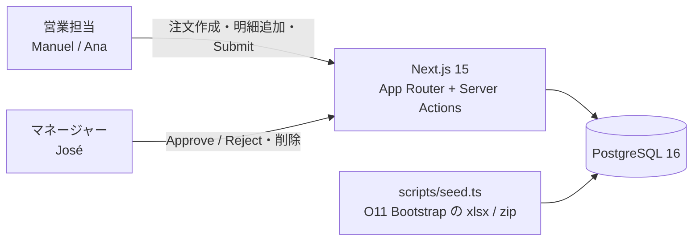
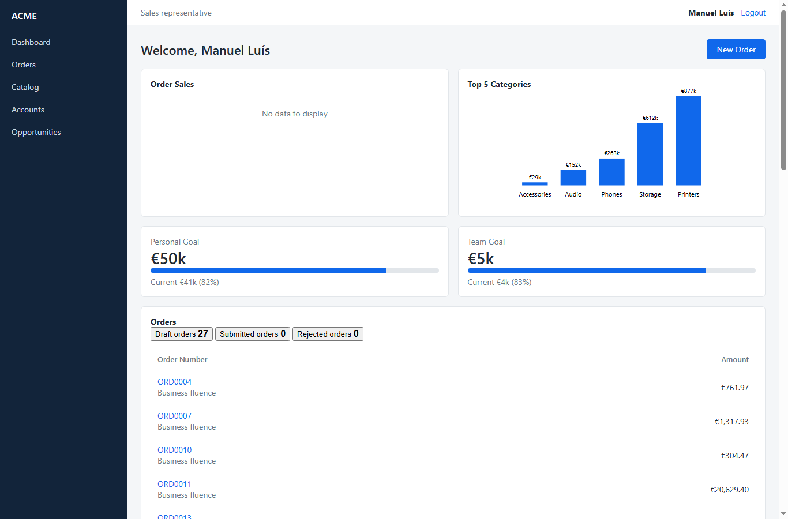
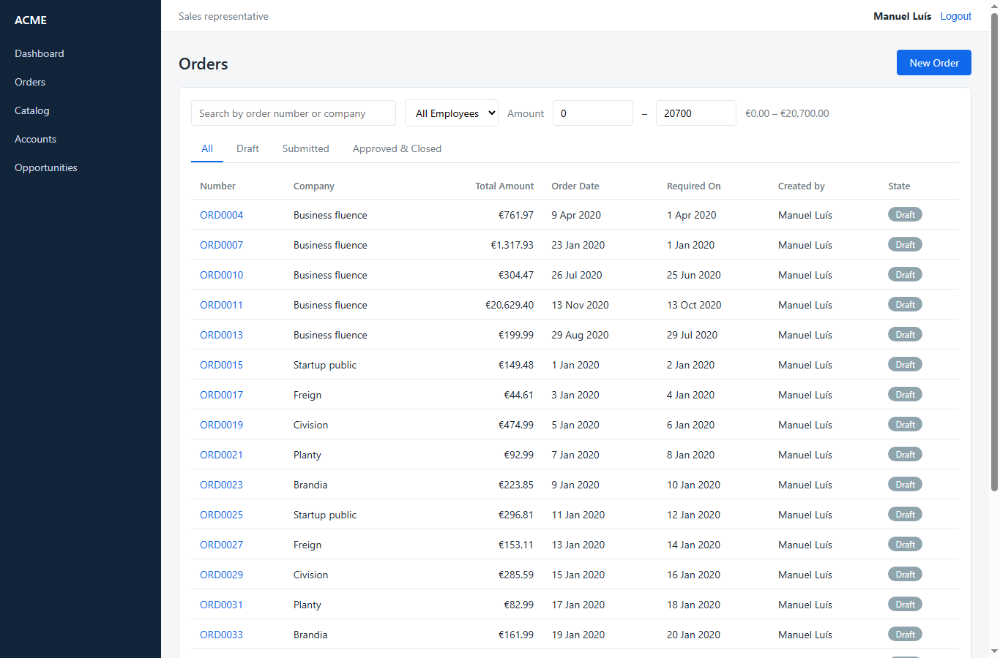
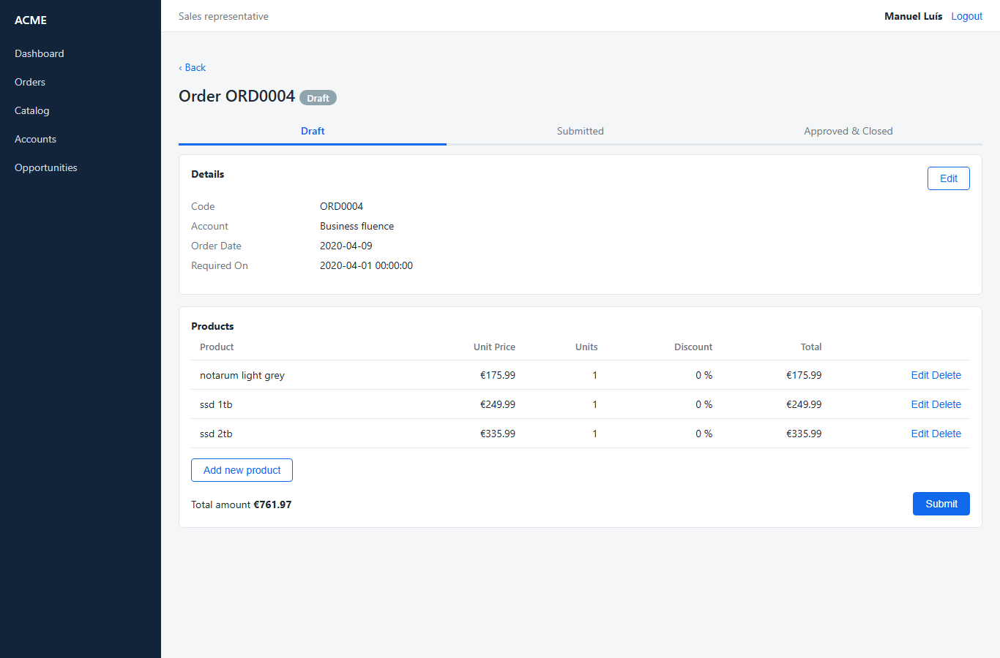
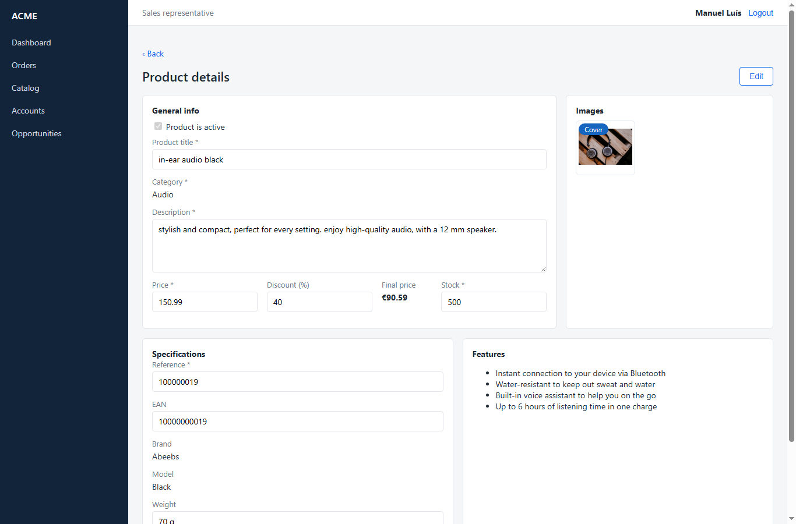

# OrderManagement（Next.js + PostgreSQL 版）

OutSystems 11 の受注管理アプリ **OrderManagement**（`personal-pimir0dg.outsystemscloud.com`）を、Next.js 15 + PostgreSQL 16 で作り直したものです。O11 の画面・業務ルール・初期データを同じにし、O11 側のグラフ描画エラーだけを直しています。

ACME 社の営業担当が顧客ごとに注文を作って商品を追加し、マネージャーが承認・却下します。



## 主な画面

| Dashboard（担当者） | Orders |
|---|---|
|  |  |
| **注文詳細** | **商品詳細** |
|  |  |

O11 との並べた比較は `docs/evidence/parity/`（`*_o11.png` と `*_next.png`）にあります。

## ドキュメント
- [現行仕様書（MCP で分かったこと / 実機で分かったこと）](docs/01_仕様書.md)
- [移行設計書](docs/02_移行設計書.md)
- [完了報告書（比較結果）](docs/03_報告書.md)
- [完了報告書（PDF 版）](docs/report/OrderManagement_移行完了報告書.pdf)

## 動かし方
前提: Node.js 20、pnpm、PostgreSQL 16

```bash
cp .env.example .env          # DATABASE_URL と SESSION_SECRET を設定
pnpm install
pnpm db:migrate               # テーブル作成
pnpm db:seed                  # O11 の初期データを投入（何度でもやり直せる）
pnpm dev                      # http://localhost:3000
```

ログイン画面の「Sample Users」から 3 名のどれかを選ぶか、ユーザー名（例 `manuel.luis@observeverything.example`）とパスワード `outsystems` でログインします。

| ユーザー | ロール |
|---|---|
| Manuel Luís / Ana Martins | 営業担当（OrderRepresentative） |
| José Felix | マネージャー（OrderManager） |

## テスト
```bash
pnpm typecheck && pnpm lint && pnpm test && pnpm build
pnpm exec playwright install chromium   # 初回のみ
pnpm test:e2e                            # データを更新するので、終わったら pnpm db:seed
```

## 構成
| パス | 内容 |
|---|---|
| `src/app/(app)/*` | 画面（O11 の Screen に対応） |
| `src/lib/services/*` | 更新系の業務ルール・検証（O11 CS の Server Action に対応） |
| `src/lib/queries/*` | 参照系（O11 の Aggregate に対応） |
| `src/db/schema.ts`、`drizzle/` | テーブル定義とマイグレーション |
| `data/outsystems-resources/` | O11 MCP の getResource で取り出した Bootstrap 用の xlsx / zip |
