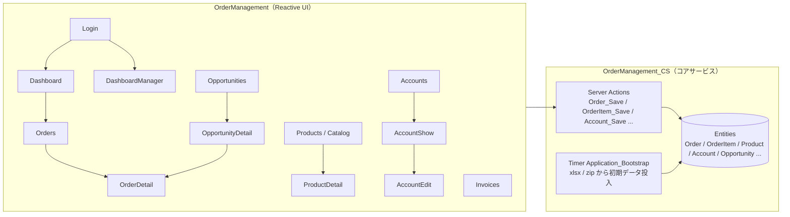
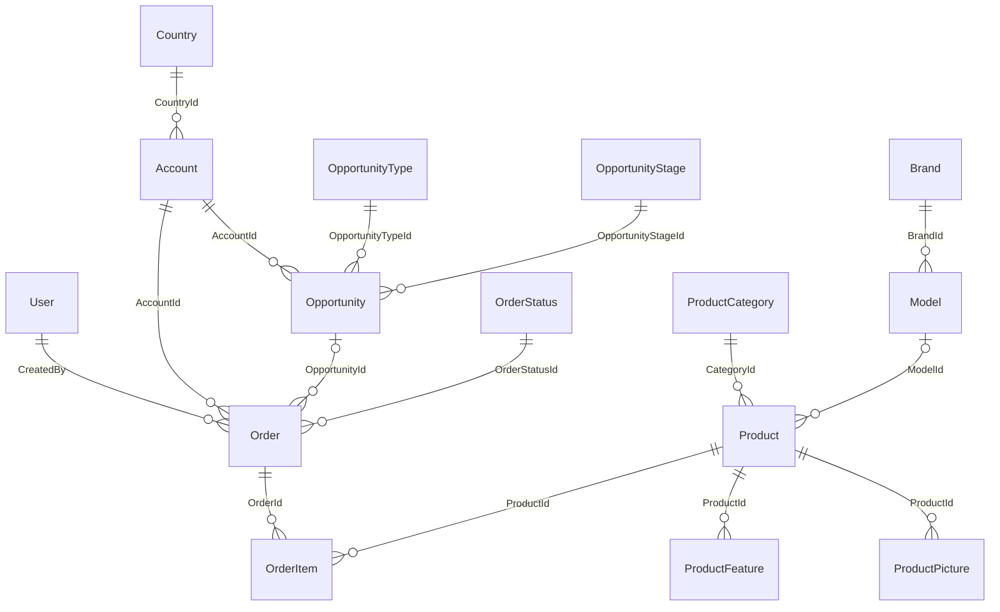

# OrderManagement 現行仕様書（OutSystems 11）

対象環境: `personal-pimir0dg.outsystemscloud.com` / eSpace `OrderManagement`（UI）・`OrderManagement_CS`（コアサービス）
調査方法: Service Studio 11.55.94 の O11 MCP（読み取り専用）と、公開中アプリの実機操作（Sample Users でログイン）。

## 0. 情報源の表記

各項目の末尾に、どこから分かったかを付けています。

| タグ | 意味 | 具体的な取得方法 |
|---|---|---|
| **[MCP]** | O11 MCP の静的解析で分かったこと | `getDataModel` / `getServerAction` / `getScreen` / `getResource` / `runQuery` などでモデル・ロジック・リソースを取得 |
| **[実機]** | 実際にアプリを動かして分かったこと | Chrome でアプリを操作し、画面表示・メッセージ・JS エラーをスクリーンショット付きで記録 |
| **[両方]** | MCP で読んだ内容を、実機でも同じだと確認したこと | — |

MCP で分かるのは「どう作られているか」（エンティティ・式・権限・画面の部品）です。実機でしか分からないのは「実際にどう見えるか・動くか」（JS ランタイムエラー、表示上の丸め、実データの見え方、メニューに出ない画面など）です。

## 1. システム概要

ACME 社の営業向け受注管理アプリ。営業担当（Sales representative）が顧客（Account）ごとに注文（Order）を作り、商品（Product）を明細として追加して申請し、営業マネージャー（Sales manager）が承認または却下します。商談（Opportunity）から注文を作ることもできます。

## 2. モジュール構成 [MCP]

| eSpace | 種別 | 主な内容 |
|---|---|---|
| OrderManagement_CS | Reactive（サービス層） | エンティティ、静的エンティティ、サーバーアクション（Save / Validate / GenerateCode）、ロール、Bootstrap タイマー、リソース（xlsx 6 個・画像 zip 1 個） |
| OrderManagement | Reactive（UI） | 15 画面、ブロック（Dashboard_*、OrderStatus、Menu、UserInfo など）、クライアントアクション、UI 側サーバーアクション（SaveOrderItemandUpdateStock、UpdateProductStock など） |

Session 変数・Client 変数（SiteProperty から設定するもの以外）・外部連携（REST/SOAP/SAP）・独自のバリデーションメッセージ定義はありません [MCP]。例外は UserException `InvalidArgumentsException` を使います [MCP]。

## 3. ロールと認証

| ロール | 用途 | 対象ユーザー（Bootstrap） |
|---|---|---|
| OrderRepresentative | 注文の作成・更新 | Manuel Luís、Ana Martins [MCP] |
| OrderManager | 注文の承認・却下・削除 | José Felix [MCP] |
| Registered / Anonymous | O11 標準 | — |

- ログイン画面にはユーザー名・パスワードでのログインと **Sample Users** ポップアップがある。Sample Users は `Login_SampleUser(UserId)` で、パスワードなしでログインする（対象は `SampleUsers_Get` に含まれる 3 名だけ）[両方]
- Bootstrap では 3 名のパスワードを `outsystems` にしているが、実機ではこのパスワードで **ログインできない**（「Invalid username or password」）。テナント側でユーザーが既に存在するためと推定 [実機]
- ログイン後、Manager は `/DashboardManager`、担当者は `/Dashboard` に移動する（Dashboard の OnInitialize で `Client.IsOrderManager` なら DashboardManager に移動）[両方]
- 画面ごとの権限 [MCP]:

| 画面 | OrderRepresentative | OrderManager |
|---|---|---|
| Dashboard / Orders / OrderDetail / Products / ProductDetail / Accounts / AccountShow / AccountEdit / Opportunities / OpportunityDetail / Invoices | ○ | ○ |
| DashboardManager | × → InvalidPermissions | ○ |

- メニュー: ACME（ロゴ）、Dashboard、Orders、Catalog、Accounts、Opportunities。**Invoices はメニューになく、URL 直打ちでだけ開ける** [実機]

## 4. データモデル [MCP]

全属性の一覧は MCP 出力をそのまま [付録 A](appendix/A_O11データモデル_MCP出力.md) に載せています。ここでは関係と要点だけをまとめます。

| エンティティ | 種別 | 要点 |
|---|---|---|
| Account | Server | Company(100)・Code(10, `A0001`)・Contact 必須。住所・電話・メールは任意 |
| Country | Server | Code / Name。Bootstrap で 220 件 |
| Opportunity | Server | Name(`OPP0001`)・Account・Type・Stage 必須。Amount / ExpectedRevenue は Currency、Probability は Decimal(小数 0 桁) |
| Order | Server | Code(`ORD0001`)・Account・Status 必須。TotalAmount は Decimal(37,8) で明細合計を**丸めずに**保持。ExpectedClosedOn(Date) は画面の「Order Date」 |
| OrderItem | Server | Order・Product・Quantity・Discount(％)・Amount(Currency、丸めない)・IsActive |
| Product | Server | Code(`P0001`)・Name・Category・Price・Discount（**割合 0〜1**）・Stock・Reference・EAN・Model・Weight・Dimensions。`ReorderLevel` 属性もあるが、画面では使われていない |
| ProductCategory / Brand / Model | Server | マスタ。Model は Brand 配下 |
| ProductFeature / ProductPicture | Server | 商品ごとの特徴（画面では最大 4 件）、画像（Binary・IsCover。画面では最大 6 枚） |
| OrderStatus | Static | Draft(1) / Submitted(2) / Closed(3, 表示名「Approved & Closed」) / Rejected(4) |
| OpportunityStage | Static | Prospecting / Investigation / Proposal made / Negotiation / Closed won / Closed lost |
| OpportunityType | Static | New business / Existing business |
| ProductSort | Static | Name `{Product}.[Name]` / Stock `{Product}.[Stock]` / Created on `{Product}.[CreatedOn]` |

すべてのエンティティに IsActive と監査列（CreatedBy/On・UpdatedBy/On）があり、削除は **IsActive = False の論理削除** です。

### 4.1 Site Properties [MCP]（`runQuery` で値を確認）
| 名前 | 値 |
|---|---|
| Dashboard_PersonalGoal | 50000 |
| Dashboard_TeamGoalPercent | 54 |
| Dashboard_TargetValue | 10000 |
| Currency / DecimalSeparator / GroupSeparator | `€` / `.` / `,` |

### 4.2 初期データ（Timer `Application_Bootstrap`、公開時に実行）[MCP]
投入の順番: User → Country → Brand → Model → Category → Product → Account → Opportunity → Order。リソースは `Countries.xlsx`・`Accounts.xlsx`・`Categories.xlsx`・`Products.xlsx`（シートは Products / ProductModel / ProductBrand / ProductFeature）・`Opportunities.xlsx`・`Orders.xlsx`・`ProductPictures.zip`。

| 対象 | 件数 | 投入ルール |
|---|---|---|
| User | 3 | Manuel・Ana = OrderRepresentative、José = OrderManager |
| Product | 28 | Name / Description は `ToLower(Trim())`、Code は P0001 から採番、画像は zip の N.jpg → N 番目の商品（IsCover） |
| Account | 14 | Code は xlsx の行順に A0001 から採番 |
| Opportunity | 47 | CreatedBy = Manager |
| Order | 58（明細 87） | xlsx は明細 1 行 = 1 行。Code ごとに注文を作るが、**コードは ORD0001 から振り直し、ステータスはすべて Draft にする**。作成者は `ChangeSalesRep` を **xlsx の行ごとに**切り替える → Manuel 27 件・Ana 31 件 |

上記の件数は、Next.js 側の seed で O11 実機と同じになることを確認済み [両方]。

## 5. 画面仕様

### 5.1 Login
- ユーザー名 / パスワードでのログイン、「Sample Users」ボタン → 3 名の一覧（Manuel Luís・Ana Martins = Sales representative、José Felix = Sales manager）[両方]
- 未ログインで業務画面を開くと Login に戻る [実機]

### 5.2 Dashboard（担当者）/ DashboardManager（マネージャー）
| 部品 | 内容 | 根拠 |
|---|---|---|
| Welcome | 「Welcome, ユーザー名」 | [両方] |
| Order Sales（面グラフ） | `Dashboard_GetHistory`: **2020-01-01〜2020-12-31 に固定**された Closed 注文の月別合計。初期データは全件 Draft のため「No data to display」 | [MCP] 年の固定 / [実機] 空表示 |
| Top 5 Categories（棒グラフ） | `Dashboard_GetByCategory`: カテゴリ別に `Price * Qty * (100 - Discount/100)` を合計し、**AmountSum の昇順で 5 件**。タイトルは Top 5 だが実際は下位 5 件で、式も約 100 倍になる | [MCP] |
| グラフの JS エラー | 3 名とも、画面表示時に **`H.each is not a function`** のトーストが出て、グラフの描画に失敗する（凡例は Accessories, Audio, …, Storage, Printers、軸は €0〜€250k） | [実機] |
| Personal Goal（担当者） | 目標 = `Dashboard_PersonalGoal`(50000) → €50k。現在値 = 目標 × ((当月 − 0.2) / 12)。％ = 現在値 / 目標 × 100 | [MCP] 式 / [実機] €50k |
| Team Goal | 目標 = `Dashboard_TargetValue`(10000) × `Dashboard_TeamGoalPercent`(54)/100 = 5400 → €5k。現在値 = 目標 × ((当月 − 0.1)/12)（Manager 側は −0.2） | [MCP] / [実機] €5k |
| Company Goal（Manager） | 目標 = TargetValue × CompanyGoal/100。CompanyGoal は SiteProperty で設定されず、Client 変数の既定値 70 のまま → €7k | [MCP] / [実機] €7k |
| Orders（担当者） | 自分の Draft / Submitted / Rejected 注文のタブ（最大 50 件）。初期データでは Manuel の Draft 27 件 | [両方] |
| Orders（Manager） | 全員の Submitted 注文。初期データでは 0 件 | [両方] |
| Top performers | 作成者ごとに `Price * Qty * (100 - Discount/100)` を合計して降順に 5 名。O11 の表示は「€2.719k」（PrettyFormatCurrency の区切り文字の引数が逆） | [MCP] 式 / [実機] Manuel €2.719k・Ana €2.086k |
| Top products | 有効な明細の数量合計の降順に 4 商品（カバー画像・REF・在庫数） | [両方] notarum slim black / usb flash drive 128gb / notarum slim grey / printer fortis express series |

### 5.3 Orders（一覧）
- 「New Order」、検索（Account.Code・Account.Company・Order.Code の部分一致）、担当者（All Employees / 各ユーザー）、金額レンジ、タブ All / Draft / Submitted / Approved & Closed [両方]
- 金額レンジ: 下限 = Floor、上限 = Ceiling（`Int(x/100)*100+100`）→ 実機では €0.00〜€20,700.00 [両方]
- 列: Number / Company / Total Amount / Order Date（= ExpectedClosedOn）/ Required On / Created by / State。ヘッダーをクリックすると昇順・降順で並び替え [両方]
- 1 ページ 20 件、「1 to 20 of 58 items」。既定の並び（TableSort 未指定）は作成者 Id → Id 順になり、Manuel の ORD0004, ORD0007, ORD0010 … が先頭 [実機]
- 画面の「Set Pagination」アクションには `MaxRecords = 10` の代入もあるが、初期表示は 20 件 [MCP]/[実機]

### 5.4 OrderDetail（注文詳細・新規）
- ヘッダー「Order ORDxxxx」＋ステータスバッジ、ステッパー Draft → Submitted → Approved & Closed [両方]
- 新規（OrderId 未指定）: コードを先に採番して表示、Status = Draft、RequiredOn = 現在 + 1 か月、URL の AccountId・OpportunityId を初期値にする、編集モードで開く [MCP]
- Details: Code、Account（リンク）、Opportunity（ある場合）、Order Date、Required On、Shipped On（Closed で値がある場合だけ）[両方]
- 編集できる条件: 新規、または Draft・Rejected。Edit → Save / Cancel。Account 未選択だと「Account must be filled」。保存すると「The order was successfully saved.」[MCP]
- 明細テーブル: Product / Unit Price / Units / Discount / Total。「Add new product」と明細の編集・削除は Draft・Rejected のときだけ [両方]
- 明細の編集パネル「Editing Product」: 商品を選ぶと単価 = Product.Price（**商品側の割引は使わない**）と在庫を取得。数量の検証は「Out of stock」（在庫 + 既存数量 = 0）/「Only N in stock」。合計 = 単価×数量 − 単価×数量×割引/100 [MCP]
- 在庫: 明細を保存すると `Stock += 旧数量 − 新数量`、明細を削除すると数量を戻す、注文を削除すると全明細の数量を戻す [MCP]
- ボタン: Submit（Draft・Rejected で明細があるとき）、Approve / Reject（Manager かつ Submitted）、Delete order（Manager かつ Draft、確認ダイアログ「Delete this order?」「Once deleted, all changes will be lost.」、完了メッセージは原文どおり「Order deleted succefully」）。ステータスを変えると「The order status was changed.」[MCP]
- 実機の表示: Order Date は `2020-04-09`、Required On は `2020-04-01 00:00:00` のような生の日付形式 [実機]

### 5.5 Catalog（Products）/ ProductDetail
- Catalog: 「New Product」、名前の部分一致検索、カテゴリ（All Categories）、並び替え（Name / Stock / Created on、いずれも昇順）、12 件表示＋「Load more」（件数を倍にする：12 → 24 → 48）、「12 of 28 products」、カード（画像・名前・REF・N in stock）。**IsActive では絞り込まない** [両方]
- 商品名・説明は Bootstrap で小文字にして登録している（`ToLower(Trim())`）ため、画面上も小文字で表示される [両方]
- ProductDetail: 表示モード＋Edit。General info（Product is active、Product title*、Category*、Description*、Price*、Discount (%)、Final price、Stock*）、Images（最大 6 枚、先頭が Cover）、Specifications（Reference*、EAN、Brand、Model、Weight、Dimensions）、Features（最大 4 件）[両方]
- Discount は DB に**割合（0.4）**で保存し、画面では ×100 した ％ で表示。Final price = Round(Price × (1 − Discount), 2)。実機では 150.99 / 40% → €90.59 [両方]
- 画面側の検証メッセージ: 「Product name must be filled」「A category must be chosen」「Description must be filled」「Price must be filled and higher than zero」「Discount value not valid」（0〜100 の範囲外）「Stock can't be negative」「Reference must be filled」「Please upload at least one image for the cover of the product」。成功時「Product updated successfully.」、画像削除時「Image deleted successfully!」[MCP]
- 存在しない Id: 「The product you were looking for doesn’t exist.」＋「Go to Homepage」[実機]

### 5.6 Accounts / AccountShow / AccountEdit
- 一覧: 「New Account」、検索（Code・Company・Contact・City など）、既定の並び Company、20 件/ページ、列 Company / Code / Contact Name / Country/City / Phone、0 件時「There aren't any Accounts to show.」[両方]
- AccountShow: Back、Edit、「Account details」（Company Name、Primary Contact、Email、Phone、Code、Address、Country）＋その顧客の Opportunities と Closed 注文 [両方]
- AccountEdit: 「New Account」/「Account details」、Company Name、Address、Country、Code、Postal Code、Primary Contact、Phone、Email、Save / Cancel。成功時「Account '<Company>' was successfully created.」/「… updated.」[MCP]
- データ上の癖: Accounts.xlsx の Bankpeer 行は Phone が Excel の数式 `=F7+10`、Email が `4200` になっていて、実機でも Email「4200」と表示される [両方]

### 5.7 Opportunities / OpportunityDetail
- 一覧「Open Opportunities」: IsActive かつ Stage = Prospecting だけ、検索（Description・Company・Name）、最大 50 件・20 件/ページ、列 Opportunity / Company / Amount / Probability / Close Date、実機では「1 to 6 of 6 items」[両方]
- 詳細「Opportunity Details」: Account、Description、Close Date、Stage name、Is Closed（ClosedWon・ClosedLost）、Won（ClosedWon）、Amount、Expected Revenue、Probability、関連する注文（最大 10 件）、「Create New Order for Opportunity」（OrderDetail を AccountId・OpportunityId 付きで開く）[両方]

### 5.8 Invoices
- Approved & Closed の注文だけ。検索＋担当者で絞り込み。列 Number / Account / Total Amount / Employee / Order Date / Required By。初期データは全件 Draft のため「There aren't any Invoices to show.」[両方]
- メニューには出ない（URL 直打ちのみ）[実機]

### 5.9 InvalidPermissions / Splash
- 権限のない画面を開くと InvalidPermissions に移動 [両方]

## 6. 業務ルールとサーバー側の検証 [MCP]

| アクション | ルール / メッセージ |
|---|---|
| Order_Save | 呼び出したユーザーが OrderManager か OrderRepresentative でなければ「You don't have permissions to execute this action.」。新規なら Code = Order_GenerateCode、Status = Draft、IsActive = True。既存でステータスを変えられるのは、ステータスが同じままか Manager のときだけ。TotalAmount = 有効な明細の Amount の合計 |
| Order_Validate | TotalAmount < 0 →「Total amount must be greater or equal to zero」、Status 未設定 →「Status is required」 |
| Order_GenerateCode / Account_GenerateCode / Product_GenerateCode | 最大コードの数字 4 桁 + 1 をゼロ埋め（ORD / A / P）。データがなければ 0001 |
| OrderItem_Validate | 「Order is required」「Product is required」「Quantity must be greater than zero」「Discount must be greater or equal to zero」、在庫不足 →「Insufficient stock to fulfill your order」 |
| OrderItem_Save | Amount = Price × Qty − Price × Qty × Discount / 100 → Order_Save で合計を再計算 |
| Account_Validate | Company が空 →「Company name is required」、Code が重複 →「Company name must be unique」、Contact が空 →「Code is required」（**メッセージと条件の組み合わせが O11 側でずれている**） |
| Product_Validate | 「Name is required」「Category is required」「Price must be greater or equal to zero」「Stock must be greater or equal to zero」 |
| Opportunity_Validate | Name の必須・重複、Type・Stage の必須、Amount・Probability・ExpectedRevenue の範囲。ここも分岐とメッセージの組み合わせがずれている（例: Probability > 100 で「Probability must be greater or equal to zero」）。O11 の画面には商談の登録・編集がないため、画面からは呼ばれない |
| *_Save 共通 | テキスト項目を Trim、作成・更新の監査列を設定 |

## 7. 既存の不具合・癖（移行版での扱い）

| # | 内容 | 根拠 | 移行版での扱い |
|---|---|---|---|
| 1 | ダッシュボードのグラフで `H.each is not a function` が出て描画に失敗する | [実機] | **直す**（SVG で描画）。データと式は O11 と同じ |
| 2 | Order Sales の対象期間が 2020 年に固定されている | [MCP] | 同じにする（初期データでは空表示で一致）。修正案を設計書に記載 |
| 3 | 「Top 5 Categories」が昇順のため実際は下位 5 件で、式も約 100 倍 | [MCP] | 同じにする（値・並びを一致させる）。修正案を設計書に記載 |
| 4 | Top performers の式 `(100 − Discount/100)` で約 100 倍になる | [両方] | 同じにする |
| 5 | Top performers / Goal の金額表記で区切り文字の引数が逆（€2.719k） | [両方] | 正しい区切りで表示（€2,719k）。**表記の差異**として比較表に記載 |
| 6 | Account_Validate / Opportunity_Validate のメッセージずれ | [MCP] | メッセージは同じにする（修正案を記載） |
| 7 | 削除完了メッセージの綴り「succefully」 | [MCP] | 同じにする |
| 8 | Bootstrap のパスワード `outsystems` で実機ログインできない | [実機] | 移行版では `outsystems` でログインできる（bcrypt でハッシュ化して保存） |
| 9 | 合計 20629.405 の表示が €20,629.40（倍精度の実値で丸めるため） | [両方] | 表示を同じにする（`toFixed(2)` と同じ丸め）。DB は numeric(37,8) で丸めずに保持 |
| 10 | Invoices がメニューにない | [実機] | 同じにする（URL 直打ちのみ） |
| 11 | Bankpeer の Phone が Excel の数式、Email が 4200 | [両方] | 同じデータを投入する |

## 8. エビデンス
- O11 実機のスクリーンショット: `docs/evidence/o11/`（ユーザー別、画面ごとに png とテキスト）
- MCP の生データ: [付録 A データモデル](appendix/A_O11データモデル_MCP出力.md)、`data/outsystems-resources/`（getResource で取り出した Bootstrap 用の xlsx / zip）
- 移行版との比較結果: [03_報告書.md](03_報告書.md)
